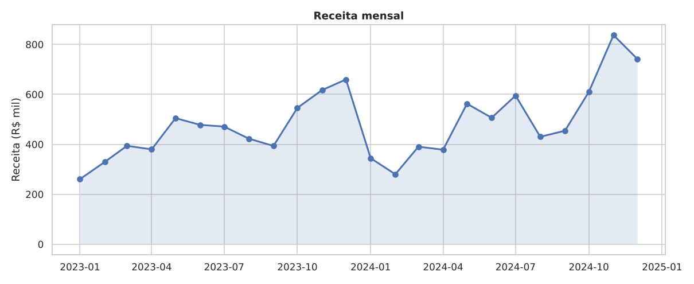
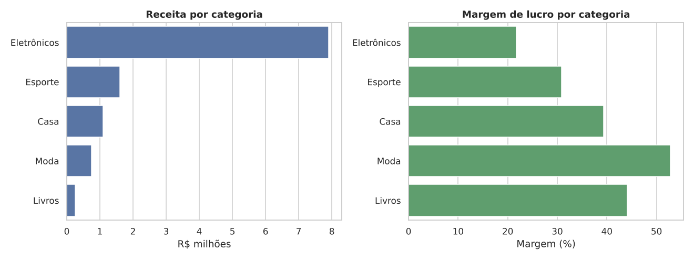
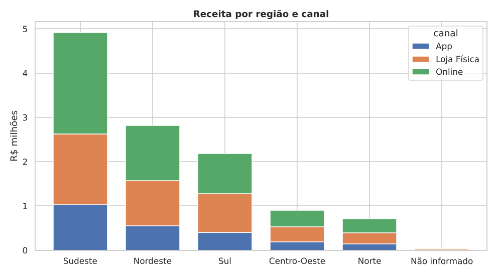
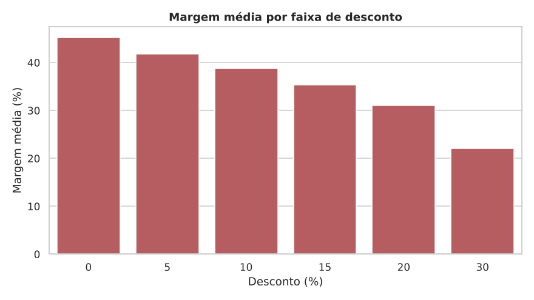
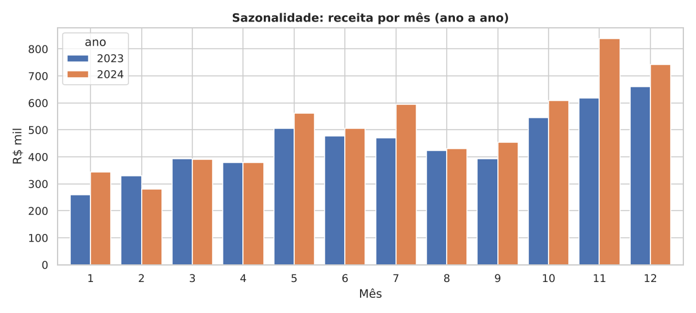
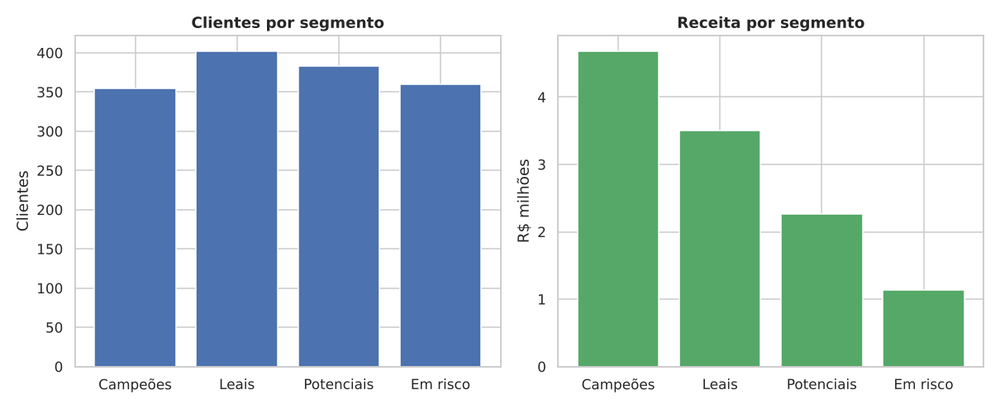

# 📊 Análise de Vendas de Varejo

Projeto de análise de dados de ponta a ponta com Python: geração/limpeza de dados, análise exploratória, visualizações, segmentação de clientes (RFM) e insights de negócio.

> **Pergunta de negócio:** Onde está o dinheiro? Quais categorias, canais, regiões e clientes mais geram receita e lucro, e como descontos e sazonalidade afetam a margem?

## 🔍 Principais resultados

| Métrica | Valor |
|---|---|
| Receita total | R$ 11,59 milhões |
| Lucro total | R$ 3,14 milhões (margem de 27,1%) |
| Ticket médio | R$ 966 |
| Crescimento 2024 vs 2023 | +12,4% |

- **Sazonalidade forte:** novembro e dezembro concentram ~25% da receita anual.
- **Descontos corroem a margem:** pedidos com desconto têm margem média de 34,0% contra 45,3% sem desconto.
- **Moda** tem a maior margem (52,8%), mas **Eletrônicos** gera o maior lucro absoluto (Notebook, Smart TV e Smartphone lideram).
- **Princípio de Pareto:** os clientes "Campeões" são 23,7% da base e geram 40,4% da receita.

Veja todos os insights em [`reports/insights.md`](reports/insights.md).

## 📈 Visualizações








## 🧰 Tecnologias

Python · pandas · NumPy · Matplotlib · Seaborn

## 🗂️ Estrutura

```
├── data/
│   └── vendas.csv            # dataset sintético (gerado por script)
├── reports/
│   ├── figures/              # gráficos gerados
│   └── insights.md           # resumo dos insights
├── src/
│   ├── gerar_dados.py        # gera o dataset (seed fixa, reprodutível)
│   └── analise.py            # limpeza, análise, gráficos, RFM
├── requirements.txt
└── README.md
```

## ▶️ Como executar

```bash
git clone https://github.com/SEU_USUARIO/analise-vendas-varejo.git
cd analise-vendas-varejo

python -m venv .venv
source .venv/bin/activate      # Windows: .venv\Scripts\activate
pip install -r requirements.txt

python src/gerar_dados.py      # cria data/vendas.csv
python src/analise.py          # gera gráficos e insights
```

## 🧪 Metodologia

1. **Limpeza:** remoção de pedidos duplicados e tratamento de regiões nulas (o dataset tem sujeira proposital para demonstrar essa etapa).
2. **Feature engineering:** ano, mês, margem de lucro por pedido.
3. **Análise exploratória:** receita ao longo do tempo, categorias, região × canal, desconto × margem, sazonalidade.
4. **Segmentação RFM:** clientes pontuados de 1 a 4 em Recência, Frequência e Valor e agrupados em *Campeões*, *Leais*, *Potenciais* e *Em risco*.

## 💡 Recomendações de negócio

- Reduzir descontos agressivos em categorias de margem baixa, concentrando promoções em Moda, que comporta descontos maiores.
- Reforçar estoque e campanhas antes de novembro e dezembro.
- Criar programa de fidelidade para os clientes Campeões e campanhas de reativação para os "Em risco".

## 🚀 Próximos passos

- [ ] Previsão de vendas com séries temporais (Prophet/ARIMA)
- [ ] Dashboard interativo (Streamlit ou Power BI)
- [ ] Clusterização com K-Means para comparar com o RFM
- [ ] Testes de hipótese (ex.: o canal online realmente vende mais?)

## 📝 Observação

Os dados são **sintéticos**, gerados para fins de portfólio. A estrutura do projeto funciona com qualquer base de vendas com colunas semelhantes.

## 📄 Licença

MIT
